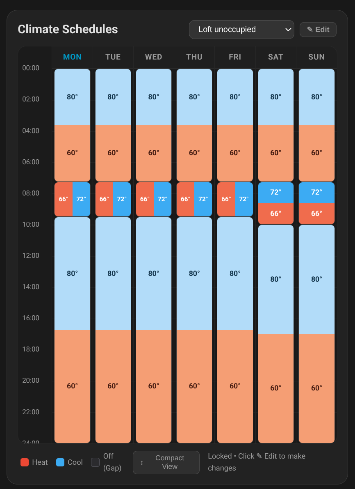
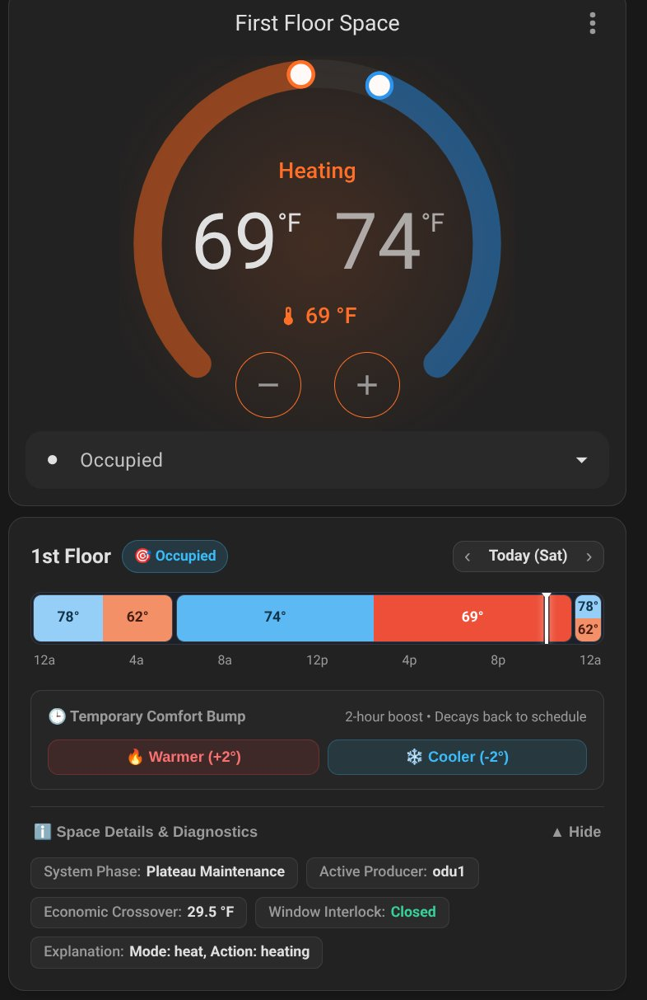
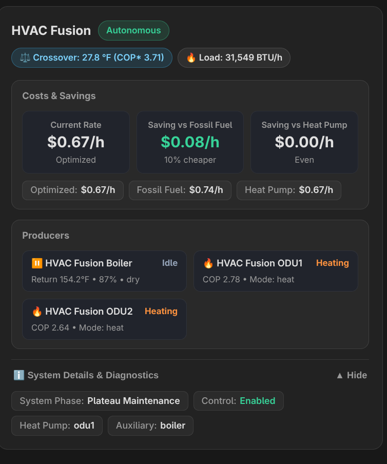

# HVAC Fusion

[](https://github.com/dlarrick/hvac-fusion/actions/workflows/test.yml)
[](https://github.com/dlarrick/hvac-fusion/releases)
[](https://github.com/dlarrick/hvac-fusion)
[](https://opensource.org/licenses/MIT)

HVAC Fusion is a Home Assistant custom integration for intelligent management of dual-fuel, multi-source, and single-source HVAC systems (e.g., heat pumps / mini-splits paired with hydronic boilers or furnaces, as well as heat-pump-only or boiler-only homes).

Those mini-splits you added to your old house sure are nice in the summer. But do you know how to use them effectively in heating season? Is it cold enough out that your boiler is a better choice? And if you do switch back & forth, does everybody in the house understand which thermostat to use? HVAC Fusion was designed to solve these problems! Even with a single heat source, you still get a nice visual 7-day schedule editor, temporary comfort bump control, multi-split conflict arbitration, and real-time cost estimation.

HVAC Fusion acts as a coordinator layer, creating virtual climate entities for living spaces while dynamically optimizing fuel switchover, avoiding multi-split refrigerant conflicts, and orchestrating underlying physical thermostats.

HVAC Fusion uses the core physics and arbitration engine from [`hvac-crossover`](https://github.com/dlarrick/hvac-crossover).

## Features

- **Economic Optimization**: Real-time COP vs. fuel tariff calculations to choose the most cost-effective heat source at current outdoor temperatures.
- **Arbitration**: Manages multi-split outdoor units (ODUs) to prevent conflicting simultaneous heating/cooling demands across indoor units (IDUs).
- **Recovery Acceleration**: Detects large temperature differentials or recovery calls to enlist high-capacity auxiliary heat (such as condensing or standard boilers).
- **Virtual Space Climate Entities**: Exposes unified climate entities to Home Assistant, controlling multiple underlying climate entities per space, for intuitive schedule and thermostat card control (`heat_cool`, `heat`, `cool`, `off`).
- **Custom Lovelace Schedule & Status Cards**: Ships with built-in dashboard cards (`schedule-preset-card` and `hvac-fusion-status-card`) for visual 7-day schedule creation and editing, real-time 24-hour preset timeline tracking, temporary comfort bump adjustments, and expandable room diagnostics.
- **Flexible Native Schedule Integration**: Follows native Home Assistant `schedule` entities via customizable preset modes.
- **Monitoring / Shadow Mode**: Supports a `control_enabled: false` mode with diagnostic reporting services to validate behavior before commanding physical equipment.

## Concept

The basic principle of HVAC Fusion:
- You divide your home into **spaces** that you would like to control the temperature of, and HVAC Fusion provides a virtual thermostat for each.
- Each space has one or more **emitters** capable of heating or cooling that space via an existing physical climate entity.
- Each emitter is connected to a **producer** with an associated efficiency profile.
- Each producer is powered by an energy (fuel) source with an associated **tariff** cost per unit of energy.

HVAC Fusion then decides, moment to moment, which emitter is most cost-effectively capable of satisfying that demand.

## Frontend Dashboard Cards

HVAC Fusion automatically bundles and serves three companion Lovelace cards for system-wide monitoring and editing climate schedules directly on your dashboards. No separate Marketplace install or manual resource entry is required—the integration's built-in loader serves and content-versions the bundle automatically.

```yaml
# Example Lovelace dashboard configuration
type: vertical-stack
cards:
  # Native Thermostat Card for space temperature & mode control
  # System-wide economics, producers, & diagnostics card
  - type: custom:hvac-fusion-system-card
    entity: sensor.hvac_fusion_economic_crossover_temperature

  - type: thermostat
    entity: climate.first_floor_space

  # Unified space status card: 24h schedule timeline, comfort bump, & diagnostics
  - type: custom:hvac-fusion-status-card
    entity: climate.first_floor_space

  # 7-day interactive weekly schedule calendar
  - type: custom:schedule-preset-card
    title: Heating & Cooling Schedules
    default_schedule: schedule.first_floor_occupied
```

### 1. `schedule-preset-card` (7-Day Schedule Calendar)
An interactive 7-day vertical timeline calendar designed to visualize and edit native Home Assistant `schedule.*` entities with multi-mode preset payloads (`hvac_mode`, `heat_to`, `cool_to`).



* **Visual Editing**: Drag to create new blocks, drag block bodies to shift times, and drag top/bottom edge handles to adjust start and end times in 15-minute increments.
* **Block Actions**: Click any block to edit temperatures and HVAC mode, split a block into two, or copy blocks across weekdays, weekends, or all days.
* **Schedule Switcher**: A dropdown menu lets you quickly switch between different configured schedules on the fly.
* **Compact & Full Views**: Toggle between a compact `280px` overview (4-hour time marks) and a full `580px` detailed editor (2-hour time marks).
* **Live Synchronization**: Real-time cross-card bus and background WebSocket polling ensure edits made anywhere—in another card, another browser tab, or via external automations and services—are reflected without needing a page refresh.

### 2. `hvac-fusion-status-card` (Unified Space Status & Comfort Bump Card)
A comprehensive companion card for living space dashboards bringing together 24-hour schedule awareness, intuitive temporary temperature adjustments, and live operational diagnostics.



* **24-Hour Preset Timeline**: Displays today's scheduled comfort bounds and active preset mode with a live high-contrast "NOW" progress needle updating every 30 seconds.
* **Temporary Comfort Bump**: Provides one-tap `🔥 Warmer (+2°)` and `❄️ Cooler (-2°)` adjustments that stack up to ±5°F and decay linearly back to the active schedule over 2 hours without mutating underlying schedule definitions.
* **Space Details & Diagnostics**: An expandable accordion displaying real-time system phase (e.g. *Plateau Maintenance*, *Setback Recovery*), active producer, window interlock state, cycling emitter status, and coordinator explanation strings.
* **Day Navigation**: Flip between days (`‹ Today ›`) to inspect upcoming schedule routines.

### 3. `hvac-fusion-system-card` (System Economics, Producers & Diagnostics Card)
A whole-system summary card for your main dashboard showing real-time operating mode, crossover economics, estimated costs and savings, producer status, and configurable system diagnostics.



* **Mode & Summary Header**: Displays `Autonomous`, `Dry Run`, or `Advisory` status alongside the live economic crossover temperature, break-even COP (`COP*`), and total estimated space heat-loss load (`BTU/h`).
* **Costs & Savings**: Shows the estimated optimized heating rate (`$/h`), hourly savings (`$/h` and `%` cheaper) compared against fossil-fuel-only and heat-pump-only baselines (modeled from your space parameters, outdoor temperature, tariffs, and producer profiles), and side-by-side baseline rate pills. (Cumulative `total_increasing` cost/savings sensors are also exposed for Home Assistant Statistics Graphs and Utility Meters.)
* **Producers**: Compact status cards for every configured producer (`Idle`, `Heating`, `Cooling`, `Locked Out`) with live telemetry (heat pump COP and mode lock, boiler return temperature, efficiency, and condensing state).
* **System Details & Diagnostics**: Expandable drawer with selectable diagnostic pills for `system_phase`, `break_even_cop`, `control_enabled`, `heat_pump`, `auxiliary_producer`, and `cumulative_estimated_cost`.

### Edit Protection
When you click `[ ✎ Edit ]` in `schedule-preset-card`, the schedule editor is protected against simultaneous edits from automations or other tools until you click `[ ✓ Done ]` (or after a short timeout). All cards also work standalone if used without the HVAC Fusion integration.

## Installation

### Via Marketplace (Recommended)

[](https://my.home-assistant.io/redirect/hacs_repository/?owner=dlarrick&repository=hvac-fusion&category=integration)

Or manually add as a Custom Repository in Marketplace (formerly HACS):
1. Ensure [Marketplace (HACS)](https://hacs.xyz/) is installed in Home Assistant.
2. In Marketplace, navigate to **Integrations** > **Custom repositories** (or open the top-right menu).
3. Add `https://github.com/dlarrick/hvac-fusion` with category **Integration**.
4. Download and restart Home Assistant.

### Manual Installation

Copy the `custom_components/hvac_fusion` directory into your Home Assistant `<config_dir>/custom_components/` directory and restart Home Assistant.

## Configuration

HVAC Fusion is configured via the Home Assistant UI (ConfigFlow). Add the integration and provide some basic inputs, then use Configure to finish describing your HVAC system.

### Basic
Even if your HVAC system is not integrated with Home Assistant, there's still value in knowing your economic crossover point.

Configure the following:

- Outside temperature sensor. This sensor can be (and often is) from a weather forecast entity.
- Producers. Your boiler(s), heat pump(s), and (soon) furnaces. Use a generic model, or look up & contribute a profile for your actual model in [`hvac-profiles`](https://github.com/dlarrick/hvac-profiles).
- Fuel tariffs. The price per unit for each of your fuel sources. This can be a fixed number, a sensor, or an input number.

With this configuration HVAC Fusion provides advisory and equipment entities:

- **Economic crossover temperature** -- outdoor break-even temperature where heat pump and boiler match costs (with `break_even_cop` as an attribute).
- **Producer status sensors** -- operational state (`idle`, `heating`, `cooling`, `locked_out`) and telemetry (current COP, derate, fuel rate, boiler return temp, efficiency, condensing state) for each configured unit.

### Space-Aware Advisory (Dumb Thermostats / Non-Connected Equipment)

Even if your boiler uses a dumb wall thermostat or your mini-split has no Wi-Fi integration, you can still go beyond the producer-only baseline by defining **Spaces** and **Emitters** without a controllable `entity_id`:

1. **Add a Space** under **Manage Spaces**: enter its room temperature sensor, floor area, ceiling height, and insulation/envelope score.
2. **Attach Emitters** to the space (mini-split head capacity, hydronic emitter type such as baseboard vs. radiant floor, etc.) and **leave the Physical Actuation Entity blank**.

With this in place, HVAC Fusion models your space's actual heat-loss load, boiler short-cycling, and return-water temperature efficiency penalties—producing a much more rigorous **space-aware economic crossover temperature** (both per-space and UA-weighted across spaces) while safely skipping hardware actuation for any emitter without an entity.

> **Important:** Even in Advisory or Dry Run mode, each virtual Space climate entity (`climate.<space_id>_space`) must be turned on (`heat` or `heat_cool`, or an active `on` schedule block) with a heating setpoint (`heat_to`) above the outdoor temperature. If the Space climate entity or its active schedule is `off`, heat loss (`BTU/h`) and `$/hr` cost/savings estimates will remain `0` / unavailable.

### Full Configuration

If you do have smart thermostats and connected mini-splits, HVAC Fusion can do much more. Use the Configuration to define your Spaces and Emitters as described above.

> [!IMPORTANT]
> **Control your rooms through HVAC Fusion's virtual Space thermostats (`climate.<space_id>_space`), not the underlying physical thermostats.**
> HVAC Fusion creates one virtual thermostat per space. Put *these* on your dashboards and in your automations and voice assistants—HVAC Fusion handles translating your comfort setpoints and schedules into commands for whichever emitter (heat pump, boiler zone, or both) is most economical. Even if your underlying physical thermostats don't support `heat_cool` (auto) mode—or share a multi-split outdoor unit that can't heat and cool simultaneously—each virtual Space thermostat supports full `heat_cool` control and resolves mode conflicts automatically.

For complete field descriptions and setup details, see the [Configuration Reference](CONFIGURATION.md).

1. Environmental Sensors:
   - Outdoor temperature sensor
   - Solar export sensor (optional)
2. Manage Producers:
   - Boilers (natural gas, propane, or fuel oil, with manufacturer or generic profiles)
   - Heat pump outdoor units (with manufacturer or generic profiles)
   - *(Don't see your exact model? Use a generic profile for now—contributions of new equipment profiles to [`hvac-profiles`](https://github.com/dlarrick/hvac-profiles) via PR (see its [CONTRIBUTING guide](https://github.com/dlarrick/hvac-profiles/blob/main/CONTRIBUTING.md)) are very welcome!)*
3. Manage Spaces:
   - Define spaces (rooms or zones), temperature sensors, and room dimensions
   - Arbitration priority (resolves heat/cool mode conflicts across multi-split heads sharing an outdoor unit)
   - Window / door sensors (pauses HVAC in the space when open)
   - Shared boiler roles (`independent`, `primary`, `secondary` for multi-space hydronic loops)
   - **Emitters**: Attach heating/cooling delivery units to each space, along with the controlling climate entity
   - **Schedule Presets**: Link space presets directly to Home Assistant `schedule` entities defining time-of-day operating mode & setpoints
4. Tariffs, Safety Limits & Operational Policies:
   - Fuel and electricity tariffs (fixed rates or dynamic `sensor` / `input_number` entities for electric, natural gas, propane, and heating oil)
   - Heat pump low ambient safety band
   - Enable physical control (toggle for dry-run mode)
   - Setpoint cycling hysteresis band
   - Evaluation interval

#### Examples

**Open Floorplan**
This space has one hydronic zone off a boiler, and two mini-split heads in different locations. Define this as one space, with all three emitters. The hydronic zone should be marked as "Independent" shared boiler role.

**Bedrooms**
This space has one hydronic zone for the whole floor, and each bedroom has its own mini-split head. Define this as one space per room, with its own mini-split and the boiler zone in each. Whichever space has the primary thermostat for the boiler zone should be marked "Primary" and the others marked "Secondary".

> [!TIP]
> **Choosing Fuel Tariff Rates**
> When configuring energy rates for economic crossover calculations, consider how each fuel is billed:
>
> * **Utility-Metered Energy (Electricity & Natural Gas):** Metered and billed on-demand per unit consumed (kWh, therm, or CCF). Enter your effective marginal utility rate (including volumetric delivery and supply charges, but excluding fixed monthly meter charges). You can also link dynamic `sensor` entities for time-of-use (TOU) or real-time tariffs.
> * **Bulk-Delivered Fuels (Heating Oil & Propane):** Delivered and paid for in bulk to on-site storage tanks. When deciding what rate to enter:
>   * **Marginal Replacement Cost (Recommended):** In most cases, the economically optimal rate to configure is the **expected cost to replace consumed fuel** (the current market spot price or anticipated next delivery price), rather than the historical price paid on the previous delivery ticket. Treating fuel already sitting in your tank as a sunk cost ensures HVAC Fusion does not burn through cheap off-season fuel prematurely if replacing it mid-winter will be significantly more expensive.
>   * **Pre-Buy Contracts or Sufficient Seasonal Reserve (Exception):** If you locked in a fixed pre-buy contract for the winter, or your tank volume is large enough to comfortably carry you through the entire heating season without needing a refill, the contracted rate (or paid price) represents your true marginal replacement cost.
>
> You can enter a static rate per gallon in the Policies & Tariffs hub or provide an `input_number` / template `sensor` to track changing market or supplier rates dynamically.

### Dry Run Mode (Next Step Before Going Live)

Once you're ready to link your physical thermostats (`entity_id`) to your emitters, leave **Control Enabled** unchecked (Dry Run mode, enabled by default). HVAC Fusion will read your physical thermostats' live states and log the exact mode and setpoint commands it *would* send to Home Assistant's logbook/system log—without actually actuating your hardware (`control_enabled: false` on the crossover sensor). Note that your virtual Space climate entities (`climate.<space_id>_space`) still need to be in `heat` or `heat_cool` mode (not `off`) so HVAC Fusion knows your target comfort bounds when simulating load, costs, and savings.

## Entities & Attributes

HVAC Fusion creates entities for your spaces, central plant advisory, and equipment producers:

### Virtual Space Climate Entities (`climate.<space_id>_space`)
A virtual thermostat is created for each configured living space to manage target setpoints, presets, and schedules on your dashboards:
* **State / Modes:** `heat_cool`, `heat`, `cool`, `off`
* **HVAC Action:** `heating`, `cooling`, `idle`, `off`
* **Target Setpoints:** Single target temperature or dual heating/cooling setpoints (`target_temp_low`, `target_temp_high`)
* **State Attributes:**
  * `space_id`: Identifier for the thermal zone.
  * `preset_mode`: Currently active preset mode (`manual` or user-defined preset).
  * `active_schedule`: Entity ID of the Home Assistant `schedule` entity currently driving this preset (if linked).
  * `schedule_editing`: `true` while the linked schedule is locked for interactive editing.
  * `presets`: Mapping of configured preset names to their linked Home Assistant `schedule` entities.
  * `active_producer`: ID of the producer currently supplying heating or cooling to this space (`None` when idle).
  * `active_delivery_units`: List of emitter delivery unit IDs currently commanded active.
  * `cycling_emitters`: List of emitter IDs currently held by setpoint limit cycling hysteresis.
  * `economic_crossover_temp`: Space-specific economic crossover temperature in `°F` accounting for the emitters serving this space.
  * `window_open`: `true` if an associated window or door contact sensor is currently open (pausing conditioning).
  * `phase`: Operational phase for this living space (`plateau_maintenance`, `setback_recovery`, or `passive_ventilation`).
  * `in_recovery`: `true` if the room has an active thermal deficit meeting or exceeding the setback recovery threshold.
  * `explanation`: Human-readable summary of the coordinator's dispatch reasoning for this space.
  * `current_boost`: Current temporary comfort bump offset in `°F` (`0` when inactive).

### Economic Crossover Temperature Sensor (`sensor.<coordinator_id>_economic_crossover_temperature`)
System-wide advisory sensor indicating the outdoor temperature break-even point between heat pump heating and auxiliary fuel:
* **State:** Outdoor crossover temperature in `°F` (`device_class: temperature`). If the outdoor temperature is below this threshold, auxiliary heat is more cost-effective than running the heat pump.
* **State Attributes:**
  * `break_even_cop`: The coefficient of performance the heat pump must achieve to match auxiliary fuel cost at current tariffs.
  * `heat_pump`: Equipment ID of the heat pump evaluated in the crossover calculation.
  * `auxiliary_producer`: Equipment ID of the auxiliary boiler or furnace compared against the heat pump.
  * `system_phase`: Macro-system operational phase (`plateau_maintenance`, `setback_recovery`, `passive_ventilation`, `away_coast`).
  * `control_enabled`: `true` when physical thermostat actuation is enabled; `false` in simulation (dry-run) mode.
  * `advisory_only`: `true` when no emitters have a controllable `entity_id` configured.

### Producer Status Sensors (`sensor.<coordinator_id>_<producer_id>`)
A dedicated status sensor is created for each piece of heating or cooling equipment (heat pump outdoor unit, boiler, or furnace):
* **State:** Operational status (`idle`, `heating`, `cooling`, `locked_out`).
* **Common Attributes:**
  * `producer_id`: Equipment identifier.
  * `producer_type`: Equipment archetype (`inverter_heat_pump`, `modulating_boiler`, `atmospheric_boiler`, `steam_boiler`, `furnace`).
  * `nominal_capacity_btu`: Configured nominal rated capacity in BTU/h.
  * `active_spaces`: List of living space IDs currently calling this producer.
  * `active_delivery_units`: List of emitter delivery unit IDs currently commanded on.
* **Heat Pump Specific Attributes:**
  * `current_cop`: Real-time estimated COP at current outdoor temperature.
  * `capacity_derate_pct`: Percentage of nominal heating capacity available at current outdoor temperature.
  * `mode_lock`: Multi-split refrigerant cycle mode lock enforced across indoor heads (`heat`, `cool`, or `None`).
  * `safety_lockout`: `true` if outdoor temperature is below the low-ambient envelope plus safety margin.
* **Boiler & Furnace Specific Attributes:**
  * `fuel_type`: Energy source (`natural_gas`, `oil`, `propane`).
  * `rated_afue`: Rated combustion efficiency.
  * `has_outdoor_reset`: `true` if modulating boiler outdoor reset curve is enabled.
  * `estimated_return_temp_f`: Estimated return water temperature (for modulating condensing boilers).
  * `estimated_efficiency`: Current estimated operating combustion efficiency based on load and return water temperature.
  * `condensing_state`: Flue gas condensing state (`condensing` vs. `dry`).

### Cost & Baseline Savings Sensors
Physics-based operating cost and savings estimates modeled from your space envelope, rated AFUE / heat-pump COP curves, outdoor temperature, and configured fuel/electric tariffs:
* **`sensor.<coordinator_id>_estimated_heating_cost_rate` (`USD/h`):** Instantaneous estimated hourly heating cost rate for the currently chosen heat source(s), with attributes comparing against fossil-fuel-only and heat-pump-only baselines (`fossil_fuel_baseline_cost_per_hr`, `heat_pump_baseline_cost_per_hr`, `savings_vs_fossil_fuel_per_hr`, `savings_vs_heat_pump_per_hr`, `total_heat_loss_btu_per_hr`, `cumulative_estimated_cost`).
* **`sensor.<coordinator_id>_estimated_savings_vs_fossil_fuel` (`USD`):** Cumulative estimated savings compared to running fossil fuel alone (persisted across restarts), with attributes for cumulative savings vs. heat-pump-only and cumulative baseline totals.
* **Opt-In Matrix Sensors (disabled by default):** Six additional `USD/h` and cumulative `USD` sensors for tracking chosen cost, fossil-fuel baseline, heat-pump baseline, and savings vs. heat pump individually in Home Assistant Statistics Graphs and Utility Meters.

## Companion Integration: [HVAC Butler](https://github.com/dlarrick/hvac-butler)

Looking for weather- and occupancy-aware schedules that adapt automatically to real life? **[HVAC Butler](https://github.com/dlarrick/hvac-butler)** layers an attentive AI climate supervisor on top of HVAC Fusion (with strict non-AI safety guardrails)—automatically discovering your HVAC Fusion spaces, maintaining a `"Butler"` schedule preset for each room, and issuing temporary comfort boosts when occupancy or weather shifts.

## Acknowledgments & Attribution

The visual presentation, dual-setpoint interaction, and weekly calendar layout in `schedule-preset-card` are adapted from and inspired by the excellent work of **[arozoire](https://github.com/arozoire)** in [`schedule_creator`](https://github.com/arozoire/schedule_creator) and `weekly-schedule-card` (MIT Licensed), re-engineered here to operate natively with Home Assistant's built-in `schedule.*` helper entities and Core WebSocket APIs.

Manufacturer equipment performance profiles are fetched at runtime from **[hvac-profiles](https://github.com/dlarrick/hvac-profiles)**, licensed under [CC BY-SA 4.0](https://creativecommons.org/licenses/by-sa/4.0/).

## License

This project is licensed under the MIT License - see the [LICENSE](LICENSE) file for details.
