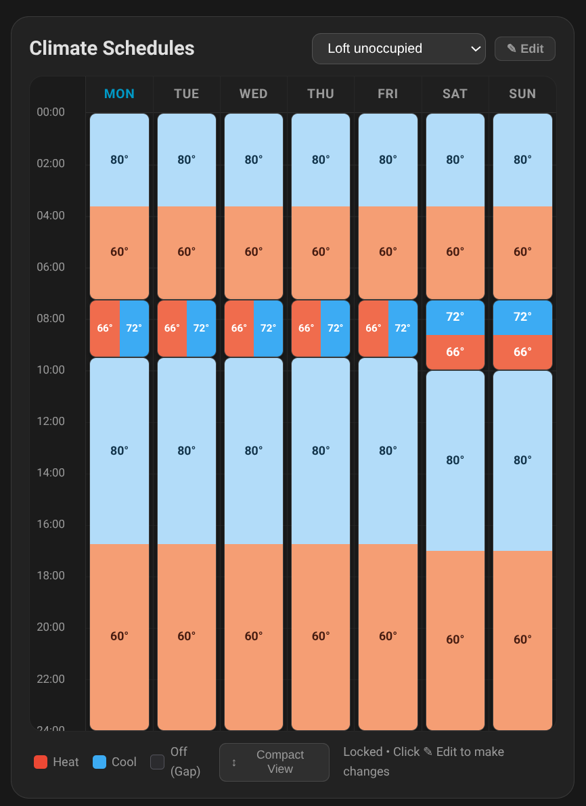
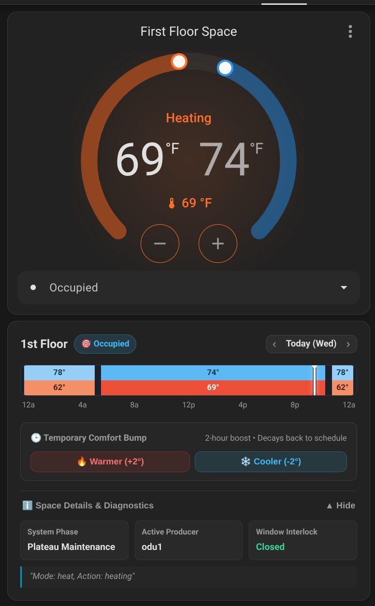

# HVAC Fusion Cards

A suite of Home Assistant Lovelace custom cards for viewing and editing climate preset schedules backed by native **`schedule.*`** helper entities and tracking live space preset states.

Bundles two companion cards in a single unified bundle (`dist/hvac-fusion-cards.js`):
1. **`custom:schedule-preset-card`**: 7-day interactive weekly schedule calendar editor.
2. **`custom:hvac-fusion-status-card`**: Unified space status card with 24-hour preset schedule, temporary comfort bump, and room diagnostics (aliases legacy `custom:climate-preset-timeline`).

---

## Features

### 1. 7-Day Schedule Calendar (`custom:schedule-preset-card`)



* **Native HA WebSocket Backend**: Reads and updates native `schedule.*` entities directly using Home Assistant's Core `schedule/list` and `schedule/update` WebSocket APIs—no custom daemons or non-standard storage engines required.
* **Dual Setpoint Visualization**:
  * **Cooling Scale (Blue)**: Colder targets are deeper azure/navy; warmer targets are soft ice blue.
  * **Heating Scale (Red/Warm)**: Warmer targets are deep rich crimson; cooler targets are soft peach/cream.
  * **Unconfigured Gaps**: Rendered in dark neutral gray (handled by `hvac-fusion` as system `off`).
* **Aspect-Ratio-Aware Block Rotation**:
  * **Normal/Long duration blocks**: Vertical split (Top half cooling blue, bottom half heating red).
  * **Short duration blocks (< 45 min)**: Division rotates by 90° into a side-by-side format (Left heating, right cooling) so temperature values and color bands remain legible.
* **Interactive Editing**:
  * Drag top and bottom edges to resize start/end times with 15-minute snapping.
  * Drag block bodies to shift times across the day.
  * Click anywhere on an empty track to create a new block.
  * Click any block to open the preset modal dialog:
    * Mode selector: `heat_cool`, `heat`, `cool`, `off`.
    * Dual setpoint steppers with minimum deadband enforcement.
    * Quick copy shortcuts: "Copy to Weekdays", "Copy to Weekend", "Copy to All 7 Days".
    * Split block tool into two segments.
    * Delete block button.
* **Schedule Switcher**: Dynamically switch between any configured schedules without reconfiguring the card.
* **Compact / Full View Toggle**: Switch between compact `280px` overview (4-hour time marks) and full `580px` view (2-hour marks).

### 2. Unified Space Status Card (`custom:hvac-fusion-status-card`)



* **24-Hour Preset Timeline**: Displays today's scheduled comfort bounds and active preset mode with a live high-contrast "NOW" progress needle updating every 30 seconds.
* **Temporary Comfort Bump**: Provides one-tap `🔥 Warmer (+2°)` and `❄️ Cooler (-2°)` adjustments that stack up to ±5°F and decay linearly back to the active schedule over 2 hours without mutating underlying schedule definitions.
* **Space Details & Diagnostics**: An expandable accordion displaying real-time system phase (e.g. *Plateau Maintenance*, *Setback Recovery*), active producer, window interlock state, cycling emitter status, and coordinator explanation strings.
* **Day Navigation**: Flip between days (`‹ Today ›`) to inspect upcoming schedule routines.
* **Backwards Compatibility**: Seamlessly aliases legacy `custom:climate-preset-timeline` card configurations.

### 3. Live Synchronization & Safety Locks
* **Live Synchronization**: Real-time cross-card bus and background WebSocket polling ensure edits made anywhere—in another card, another browser tab, or via external automations and services—are reflected without needing a page refresh.
* **Edit Mode Lock**: Clicking `[ ✎ Edit ]` in `schedule-preset-card` invokes `hvac_fusion.acquire_schedule_lock` (setting `schedule_editing: true` on the climate entity) so automated supervisors know not to overwrite the schedule while a human is editing.

---

## Configuration Examples

### 7-Day Schedule Calendar

```yaml
type: custom:schedule-preset-card
title: "1st Floor Schedule"
default_schedule: schedule.first_floor_occupied
temperature_unit: "°F"     # Optional: "°F" or "°C" (default: "°F")
step_size: 15              # Snapping interval in minutes (default: 15)
min_deadband: 2            # Minimum degrees between heat and cool (default: 2)
```

### Unified Space Status Card

```yaml
type: custom:hvac-fusion-status-card
entity: climate.first_floor_space
```

---

## Development & Building

Install dependencies and start the local Vite development server:

```bash
cd frontend
npm install
npm run dev
```

Run TypeScript type-checking:
```bash
npm run typecheck
```

Build the production bundle:
```bash
npm run build
```
Outputs to `dist/hvac-fusion-cards.js` and automatically copies to `custom_components/hvac_fusion/frontend/`.

---

## Acknowledgments & Attribution

The visual presentation, dual-setpoint interaction, and weekly calendar layout in `schedule-preset-card` are adapted from and inspired by the excellent work of **[arozoire](https://github.com/arozoire)** in [`schedule_creator`](https://github.com/arozoire/schedule_creator) and `weekly-schedule-card` (MIT Licensed), re-engineered here to operate natively with Home Assistant's built-in `schedule.*` helper entities and Core WebSocket APIs.
